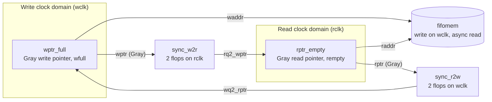

# Asynchronous FIFO

A Gray-pointer asynchronous FIFO in SystemVerilog with a class-based testbench. The RTL follows the structure in Clifford Cummings, "Simulation and Synthesis Techniques for Asynchronous FIFO Design" (SNUG 2002).

## RTL (`Asyc_fifo_Verif/rtl`)

| Module | Role |
|---|---|
| `fifo1` | Top level. `DSIZE` is the data width (8) and `ASIZE` the address width (4), so the default is 16 words of 8 bits. |
| `fifomem` | Dual-port memory. Written on `wclk`, read asynchronously. |
| `wptr_full` | Binary and Gray write pointers and the `wfull` flag, in the write clock domain. |
| `rptr_empty` | Binary and Gray read pointers and the `rempty` flag, in the read clock domain. |
| `sync_r2w`, `sync_w2r` | Two-flop synchronizers that carry the Gray pointers across the clock domains. |

The pointers are one bit wider than the address so full and empty can be told apart. `wfull` compares the next Gray write pointer with the synchronized read pointer (top two bits inverted, the rest equal). `rempty` compares the next Gray read pointer with the synchronized write pointer.

## Testbench (`Asyc_fifo_Verif/env`)

- `generator` creates random packets, `driver` writes them on `wclk`, and `monitor` reads on `rclk`.
- `scoreboard` compares the written data with the read data in order and samples a covergroup on write and read operations.
- `clockGenerator` and `resetGenerator` provide independent write and read clocks and resets.
- `tc/test_fifo_full.tc` writes 16 words with no reads, which fills the FIFO.
- `sim/Makefile` is a VCS flow with line, condition, FSM, toggle, and branch coverage. `sim/case_001.vdb` is the coverage database from one run.

The test top, interface, packet definition, and file lists used for that run are not in this repository, so the testbench does not build on its own.
